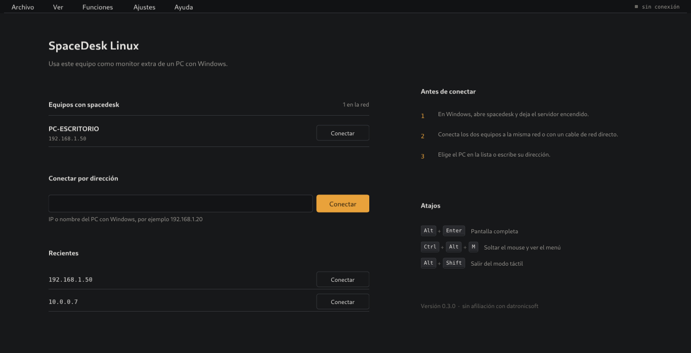
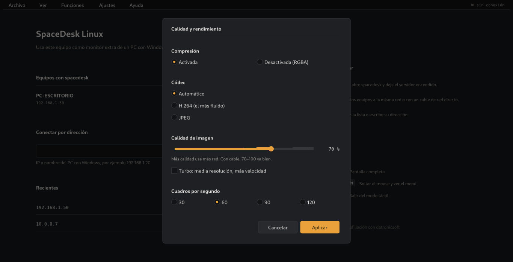

# SpaceDeskLinux

Native Linux **viewer** for [spacedesk](https://www.spacedesk.net/): turn a Debian machine into an
extra monitor for a Windows PC running the spacedesk server. It speaks the spacedesk protocol
directly — H.264 with VA-API hardware decoding, JPEG and raw modes, input forwarding and audio —
instead of the browser-based HTML5 viewer. Tested on Debian 12 (GNOME Wayland).

This is an independent, clean-room interoperability project; it is **not affiliated with
datronicsoft**.





## Features

- **Display** — H.264 (hardware VA-API or software) through FFmpeg, JPEG (TurboJPEG) and raw
  RGBA/YUV; quality and 30/60/90/120 fps, steady 60 fps at native resolution (server pacing + GPU
  scaling); native or custom resolution; "turbo" mode (reduced resolution, upscaled locally).
- **Input** — mouse remote (captured pointer, relative motion like the official Windows viewer),
  mouse as touch, touchscreen (absolute) or touchpad (relative); keyboard by **physical keys**, so
  the Windows keyboard layout applies (Spanish ñ/accents work).
- **Audio** — the Windows sound played on the Linux speakers through a separate Speaker session.
- **Connection** — LAN discovery, recent servers, automatic connect and reconnect; works over a
  direct cable with no router.
- **UI** — redesigned interface (0.3.0), menus equivalent to the official viewer, status bar
  (traffic, codec, fps, Mbps), full screen, keep monitor active.

## Requirements

- Windows PC with the **spacedesk Driver (server) 2.2.x** running.
- Linux with **SDL2 2.0.18+** and **FFmpeg** (libavcodec 59+); **libva** (with the `iHD` driver) is
  optional, for hardware H.264.
- Both machines on the same LAN. The spacedesk installer opens the required Windows firewall ports.

## Install

### Download

Prebuilt x86_64 binaries are attached to each release at
<https://github.com/MarcozVD/SpaceDeskLinux/releases> (asset `sdviewer-0.3.1-linux-x86_64` plus its
`.sha256`):

```sh
chmod +x sdviewer-0.3.1-linux-x86_64
sha256sum -c sdviewer-0.3.1-linux-x86_64.sha256
./sdviewer-0.3.1-linux-x86_64
```

Built on Debian 12 (bookworm). Runtime packages: `libsdl2-2.0-0`, `libavcodec59`, `libavutil57`,
`libturbojpeg0`, `libva2` (and `intel-media-va-driver` for hardware H.264). Building from source is
still available below.

**No root, via Docker** (build in a `debian:bookworm` container, then copy the binary):

```sh
docker run --rm -v "$PWD":/src debian:bookworm sh /src/viewer/docker-build.sh
sh packaging/install-user.sh dist/sdviewer <windows-ip>
```

The install script adds **"SpaceDesk Linux"** to the application menu for the current user.

**Native build** (Debian 12):

```sh
su -c 'apt-get install -y build-essential cmake pkg-config libsdl2-dev libavcodec-dev \
  libavutil-dev libturbojpeg0-dev intel-media-va-driver'
cmake -S viewer -B build && cmake --build build -j
./build/sdviewer <windows-ip>
```

Details in [`docs/development.md`](docs/development.md).

## Usage

Open **"SpaceDesk Linux"** from the application menu, or run:

```
sdviewer [-w] [--no-hw] [-v] [--version] [server]
  -w, --windowed   start windowed even if "full screen upon connect" is set
      --no-hw      disable VA-API decoding for this run
  -v, --verbose    log connection details and per-frame timing
      --version    print the version and exit
```

The server address is optional: without it the connect screen appears and lists the servers found
on the network ("Equipos con spacedesk"); you can also type an IP. Full screen on connect is set in
**Ajustes**.

### Hotkeys

| Key | Action |
|---|---|
| Alt+Enter | Toggle full screen |
| Ctrl+Alt+M | Release the mouse / show the menu |
| Alt+Shift | Leave "mouse local" (touch emulation) mode |
| Click on the video | Capture the mouse in mouse remote mode |

### Menus

| Menu | Contains |
|---|---|
| **Archivo** | Desconectar, Salir |
| **Ver** | Barra de estado, Pantalla completa (Alt+Enter) |
| **Funciones** | Pantalla, Teclado, Mouse remoto / Mouse local (usar como táctil), Pantalla táctil / Touchpad / Táctil apagado, Audio (altavoz) |
| **Ajustes** | Resoluciones, Calidad / Rendimiento, Conexión automática, Pantalla completa al conectar, Mantener monitor activo, Restablecer ajustes, Avanzado |
| **Ayuda** | Manual de spacedesk, proyecto en GitHub, Acerca de |

### Direct cable connection

No router or Wi-Fi needed: connect the Windows PC and the Linux laptop with an Ethernet cable and
give both ends a static address on the same subnet.

**Windows** (elevated prompt; adapt the adapter name, no gateway):

```bat
netsh interface ip set address name="Ethernet 3" static 192.168.50.1 255.255.255.0
rem optional, only to answer ping:
netsh advfirewall firewall add rule name="ICMP permitir" protocol=icmpv4:8,any dir=in action=allow
```

**Debian** (in the desktop session, no root) — GNOME Settings > Network > Wired > IPv4 Manual
`192.168.50.2 / 255.255.255.0`, no gateway, or:

```sh
nmcli connection add type ethernet ifname eno1 con-name spacedesk-cable \
  ipv4.method manual ipv4.addresses 192.168.50.2/24 ipv4.never-default yes ipv6.method ignore
nmcli connection up spacedesk-cable
```

Then `ping 192.168.50.1` and connect to `192.168.50.1` (type it or use Recientes; set it in
**Ajustes > Conexión automática**).

If the cable was plugged in after spacedesk started, restart the spacedesk service on Windows so the
PC also appears in the discovery list (see the discovery note in `docs/protocol.md`).

## Configuration

- `~/.config/sdviewer/settings.ini` — all viewer settings.
- `~/.config/sdviewer/device-id` — stable per-installation identifier sent to the server.
- `~/.cache/sdviewer.log` — log when started from the application menu.

## Troubleshooting

- **Server not listed** — check that both machines are on the same network and the Windows firewall
  allows spacedesk. A PC with both Ethernet and Wi-Fi may answer only on one address: use the IP
  shown in the list.
- **Black screen or artifacts** — **Ajustes > Avanzado**: disable hardware H.264, or run with
  `--no-hw`.
- **Low frame rate** — keep the native resolution of the Linux screen (a larger custom resolution
  does not look sharper and lowers fps), prefer a cable over Wi-Fi, and check `sdviewer -v`: a high
  `wait` is the server side, a high `xfer`/`upload` is this machine.
- **VA-API driver** — the viewer picks `i965` automatically when the default `iHD` build lacks video
  processing; override with `LIBVA_DRIVER_NAME=iHD` or `LIBVA_DRIVER_NAME=i965`.
- **No sound** — enable **Funciones > Audio** and check the output device in the system mixer.
- **Keys stuck** — press Ctrl+Alt+M; the viewer releases modifiers automatically when a hotkey is
  used or the window loses focus.

## How it works

Clean-room interoperability work, in two steps:

1. Document the wire protocol in [`docs/protocol.md`](docs/protocol.md) from observed traffic and
   analysis of the official clients/server ([`docs/re-log.md`](docs/re-log.md)).
2. Write an independent implementation from that document only.

[`docs/development.md`](docs/development.md) covers the toolchain, test machines, build and run
instructions and the viewer architecture.

## Status / roadmap

- [x] Protocol: identification (legacy and extended), frames, flow control, input
- [x] H.264 negotiation (extended identification, encoding 4)
- [x] Viewer: H.264/JPEG/RGBA/YUV decoding, full screen, mouse, keyboard, touch
- [x] UI redesign (0.3.0): graphite/amber theme, connect screen with discovery, menus and dialogs, status bar
- [x] UDP discovery (LAN server list) and audio (Speaker session)
- [x] Feature parity with the official viewer (menus, settings, mouse modes, audio, discovery)
- [x] Steady 60 fps at native resolution (server pacing, GPU scaling, early acks)
- [x] Direct cable connection (no router)
- [ ] Input verified by a human (mouse remote, mouse local, keyboard layout, touchscreen)
- [ ] Re-test the new UI on a Wayland session
- [ ] Pen, multi-touch, rotation
- [ ] `.deb` package
- [ ] TLS / password mode

## Third-party code

| Component | Version | License | Location |
|---|---|---|---|
| Nuklear (single-header GUI toolkit) | 4.13.2 | MIT / Public Domain | `viewer/third_party/nuklear/` |

## Legal

SpaceDeskLinux is an independent interoperability project. **spacedesk** is a trademark of
datronicsoft Inc. No vendor binaries or code are in this repository.

License: **not yet chosen**; all rights reserved until a license file is added.
